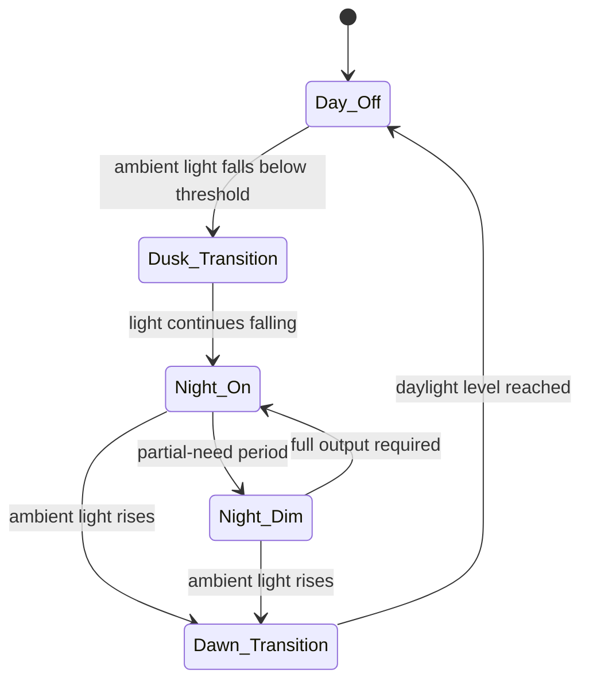

# Automatic Street-Lighting Control System

B.Sc. project, American International University-Bangladesh (AIUB). An LDR-based street-lighting controller with automatic switching and dimming, designed to cut the energy wasted by fixed-schedule lighting.

Project one-pager: [featured-streetlighting.pdf](featured-streetlighting.pdf)

# Overview

Street lights on fixed schedules burn at full power regardless of actual light conditions: late dusk, early dawn, overcast days. This controller senses ambient light directly and switches and dims output in response, so energy follows need instead of a timetable.

# Problem Statement

Design a sense-decide-actuate control loop for street lighting that (a) turns lights on when ambient light falls below a useful level, (b) turns them off at dawn, and (c) reduces output when full brightness is not required, without unstable switching at boundary light levels.

# Objectives

1. Sense ambient light with an LDR-based circuit.
2. Implement ON/OFF control logic on the sensed level.
3. Add dimming behaviour for energy savings at partial need.
4. Prototype and test the circuit.

# Hardware Setup

- LDR (light-dependent resistor) as the ambient-light sensor
- Control circuitry implementing the switching and dimming logic
- Lamp load driven by the controller output

Component-level detail is in the project one-pager (PDF, this repository).

# Software Setup

None. Control is implemented in the circuit/logic design; there is no firmware component to this project.

# Architecture

# Methodology

Prototype the sensing and control circuit on the bench; exercise it across the ambient range it will see in service (bright, dusk boundary, dark) and observe switching and dimming behaviour at each level, with attention to the boundary region where threshold controllers misbehave.

# Test Matrix

| Condition | Expected behaviour |
|---|---|
| Full daylight | Lights off |
| Falling light at dusk | Lights switch on |
| Night, full output needed | Full brightness |
| Night, partial need | Dimmed output |
| Rising light at dawn | Lights switch off |

# Investigation Process

Bench characterisation of the LDR response and the switching thresholds; the design questions are threshold placement and boundary behaviour, and they are settled empirically at the bench rather than by calculation alone.

# Evidence

- Project one-pager (PDF, this repository): design summary and results.

# Results

A working prototype implementing automatic ON/OFF switching on ambient light with dimming behaviour for energy saving, as documented in the one-pager.

# Root Cause Analysis

Not applicable; no fault investigation is part of this project. The known failure mode of this controller class is boundary flicker (oscillation around a single switching threshold); threshold design has to account for it, and it is the first thing to check in any rebuild.

# Limitations

- Bench prototype scale: one controller, not a deployed street installation.
- Source files and measurement data are not preserved (university lab). This repository is the documentation record, and performance claims are kept to what the one-pager documents.

# Lessons Learned

- The interesting engineering in a threshold controller is at the boundary, not at the extremes. Test there.
- An efficiency claim should be traceable to behaviour (when is output reduced, by how much) rather than asserted; the one-pager's dimming behaviour is the substance of this project's energy case.

# Future Work

- Rebuild with logged light-level and output data, so the energy saving is measured rather than described.
- Add hysteresis explicitly and document the two thresholds.

## Repository note

This repository holds the project documentation. The original source code was kept on a university lab machine and is not preserved; the design and results are documented here.
